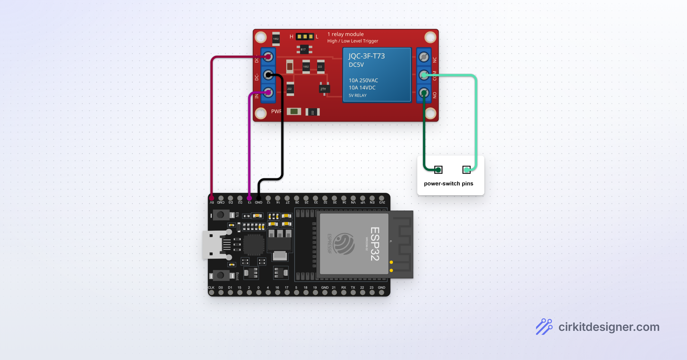
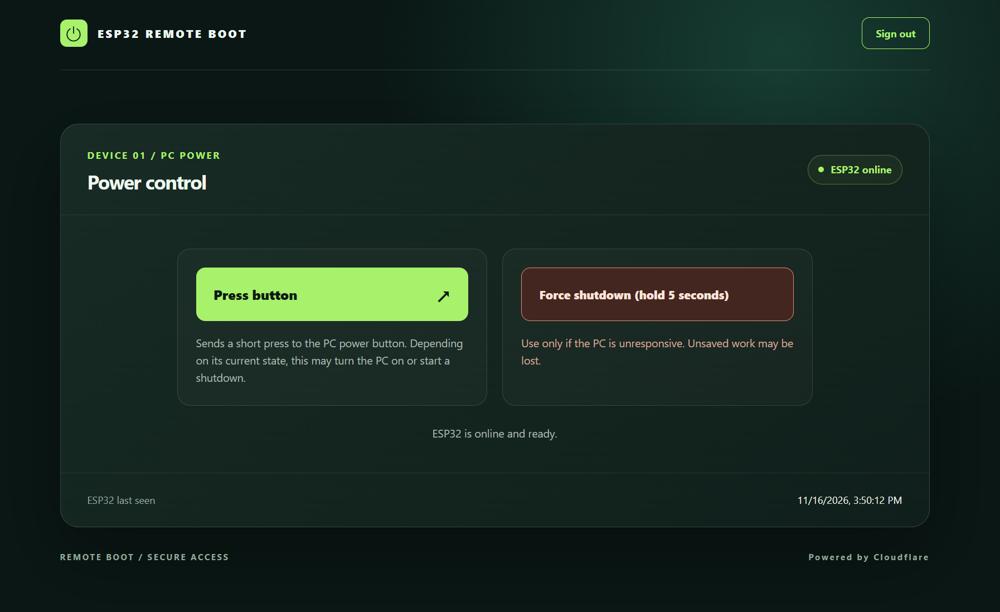

# ESP32 Remote Boot


Private, internet-accessible power-button control for one PC. Cloudflare Access protects the control page and API with your Cloudflare account sign-in; the landing page is public. An ESP32 opens an outbound, authenticated WebSocket to a separate device Worker and closes a relay for a short power-button pulse or a fixed five-second force-shutdown hold.

## The Goal

The goal is to access Jupyter Notebook running on my desktop from my laptop, even when I am on another network. This involves two steps:

1. Turn on the desktop remotely.
2. Connect to the desktop and open Jupyter Notebook.

This guide covers the first step. If the desktop is already on, skip ahead to [Access the desktop](documentations/Access-the-desktop.md) for the second step.

## How it works

```text
Browser -> public landing page (/) -> site Worker
Browser -> Access-protected /app/* -> site Worker -> Durable Object
ESP32 -> authenticated WSS -> device Worker ------> Durable Object -> relay
```

The two Workers share one strongly consistent Durable Object. The ESP32 starts the WebSocket connection from behind the home router. The device Worker pushes a command over that connection and receives an acknowledgement over the same connection. Commands expire after 90 seconds, and the service enforces ten seconds between requests. If the connection drops before an acknowledgement, the pending command is sent again on reconnect until it expires. The ESP32 stores the last command ID in flash _before_ actuating the relay, so a repeated command does not repeat the relay action. The dashboard reports whether the ESP32 is connected and whether a command remains pending; it cannot detect the PC's actual power state. A short pulse may turn on the PC or initiate shutdown depending on its current state and operating-system settings. A five-second hold can force an unresponsive PC off. The website asks for confirmation before either command.

## Cloudflare setup

You need a Cloudflare account, Node.js, and npm. A purchased domain is optional; each Worker gets a `workers.dev` URL. Check Cloudflare's current Workers and Durable Objects limits for your expected use.

1. Run `npm install` and `npx wrangler login` in the repository root.
2. Run `npm run deploy:device` first. Copy the resulting `https://remote-boot-device.<your-subdomain>.workers.dev` URL for the firmware.
3. Generate a random device token of at least 32 bytes. In PowerShell, run `$bytes = New-Object byte[] 32; [Security.Cryptography.RandomNumberGenerator]::Create().GetBytes($bytes); ($bytes | ForEach-Object { $_.ToString('x2') }) -join ''`. Save the result privately.
4. Run `npx wrangler secret put DEVICE_TOKEN -c wrangler.device.jsonc` and paste the token at the hidden prompt.
5. Run `npm run deploy:site`, then `npx wrangler secret put ALLOWED_EMAIL -c wrangler.site.jsonc` and enter the one email address that may use the website. The public landing page is available immediately; private routes return HTTP 403 until Access is configured.
6. In Cloudflare Zero Trust, configure a **Self-hosted** Access application for `remote-boot-site.<your-subdomain>.workers.dev/app/*` using your Cloudflare account sign-in. Allow only your Cloudflare account, and make sure its email matches `ALLOWED_EMAIL`. Set the session duration you prefer. Keep **Protect this Worker behind Access > All traffic** disabled so the landing page stays public, and make sure no account-level **Protect all Workers** rule covers these Workers. Do **not** put `remote-boot-device` behind Access; its token protects the WebSocket.
7. Open the `remote-boot-site` URL. The public landing page shows **Sign in to begin**. After signing in with your Cloudflare account, the protected `/app/control` page shows the ESP32 status. On later visits, a valid Access session redirects from the landing page to the controls. **Sign out** ends the Access session and returns to the landing page.

The site Worker checks Cloudflare's authenticated Access identity and the configured email on every `/app/*` request. If Access is missing, private routes return 403. The public landing page is at `/`; the sign-in check and all control API routes are under `/app/*`. Cloudflare Access logout ends the user's session across Access applications and may take up to about 30 seconds to invalidate previously issued tokens. The device Worker has no browser login and accepts only the matching device token. Keep the device token and Wi-Fi credentials out of Git.

The real token, Wi-Fi settings, and owner email belong only in local ignored files or Cloudflare secrets. Before pushing changes, check `git status` and `git diff --cached` for accidental credentials.

## ESP32 firmware

The firmware uses ESP-IDF 6.1 and targets the 4 MB flash ESP32 board identified in the boot log. `sdkconfig.defaults` and `partitions.csv` give the application a 2 MB partition for the WebSocket component. Copy `firmware/main/secrets.h.example` to `firmware/main/secrets.h` and set Wi-Fi credentials, the device Worker URL, the same device token, and the relay GPIO and active level for your hardware. The example uses GPIO 13 and an active-low relay. Keep `DEVICE_URL` as the HTTPS Worker base URL; the firmware converts it to `wss://.../connect`. The firmware verifies the WebSocket server certificate using ESP-IDF's root certificate bundle; it never disables TLS verification. The ESP-IDF component manager downloads `espressif/esp_websocket_client` during the build.

From an ESP-IDF terminal, change to the `firmware` directory and run:

```text
idf.py set-target esp32
idf.py build
idf.py -p COM_PORT flash monitor
```

Replace `COM_PORT` with your ESP32's serial port. The firmware waits for Wi-Fi and clock sync, then opens the WebSocket. It sends an application heartbeat every 30 seconds and reconnects after Wi-Fi loss.

Make sure the generated `firmware/sdkconfig` uses 4 MB flash and the custom `partitions.csv` table. Deploy the device and site Workers, then flash the firmware.

### Wiring



- Connect the relay module's **normally-open dry contacts** across the motherboard's two **power switch** header pins, in parallel with the case power button.
- Connect the relay input to the configured ESP32 GPIO and the module's power and ground according to its voltage requirements. Check that the relay input is safe for a 3.3 V ESP32 GPIO. Some modules need a transistor or level shifter.
- An active-low relay can briefly trigger during ESP32 reset if its input floats. Use a suitable external pull-up or a relay board with a safe default state, then test the relay without the PC connected before attaching the motherboard pins.

### Website controls



- **Press button** closes the relay for `RELAY_PULSE_MS` (500 ms).
- **Force shutdown (hold 5 seconds)** closes the same relay for a fixed 5,000 ms. Use it only when the PC is unresponsive.

Both controls require confirmation in the browser and share the same ten-second cooldown. The PC's actual power state is not measured, so check it before using either control.

## Test with LED


1. Wire the relay contacts, LED, and resistor as shown. Keep the relay disconnected from the motherboard power-switch pins during this test. Put the ESP32 and development PC on the same trusted Wi-Fi network.
2. On the development PC, run `npm run dev -- --ip YOUR_PC_LAN_IP` (for example, `192.168.0.41`). Allow TCP port 8787 from the ESP32 through the PC firewall.
3. In the ignored `firmware/main/secrets.h`, set `DEVICE_URL` to `http://YOUR_PC_LAN_IP:8787/device` without a trailing slash, and set `ALLOW_INSECURE_LOCAL_WS` to `1`.
4. Put the same separate test `DEVICE_TOKEN` in `secrets.h` and the ignored `.dev.vars` file. Also add `ALLOWED_EMAIL=owner@example.com` to `.dev.vars`; this matches the identity in `wrangler.local.jsonc`.
5. Rebuild and flash the ESP32, then open the dashboard at `http://YOUR_PC_LAN_IP:8787/`. Select **Sign in to begin** and test the LED control.

The local Worker simulates sign-in with a cookie and does not enforce the production Cloudflare Access policy. LAN test mode sends the token and commands without encryption. Use it only on a trusted network. After testing, restore the HTTPS `DEVICE_URL` and set `ALLOW_INSECURE_LOCAL_WS` to `0` before deployment.

## Operational limits

This is a single-PC power-button controller. It does not include actual PC power-state sensing, operating-system shutdown, or firmware update over the air. If the ESP32 is offline, the website refuses new commands. If an acknowledgement is lost, the ESP32 may have actuated the relay even though the site does not show it as acknowledged; avoid repeatedly pressing a button until you verify the PC state.
